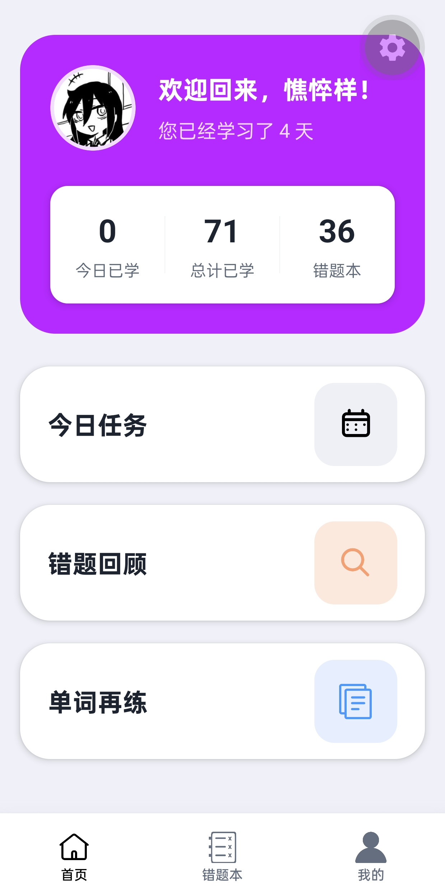
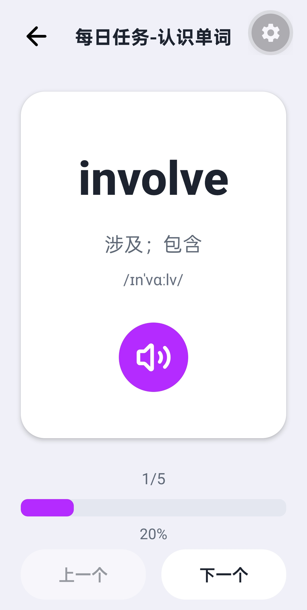
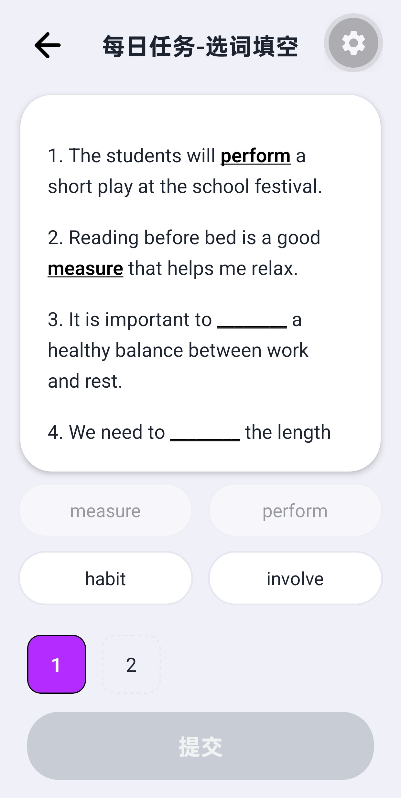
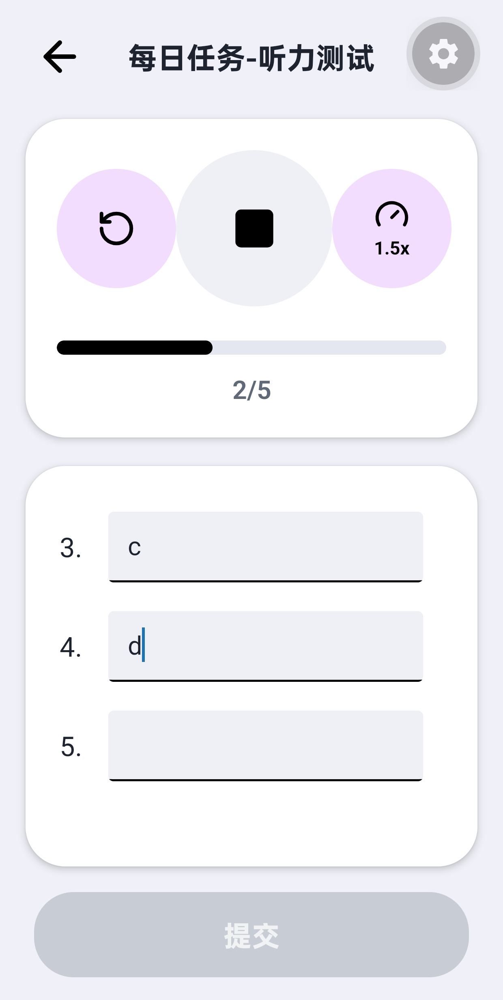
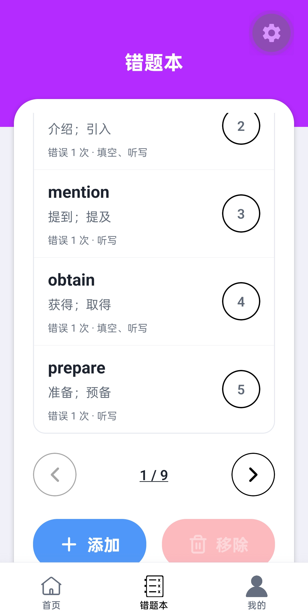
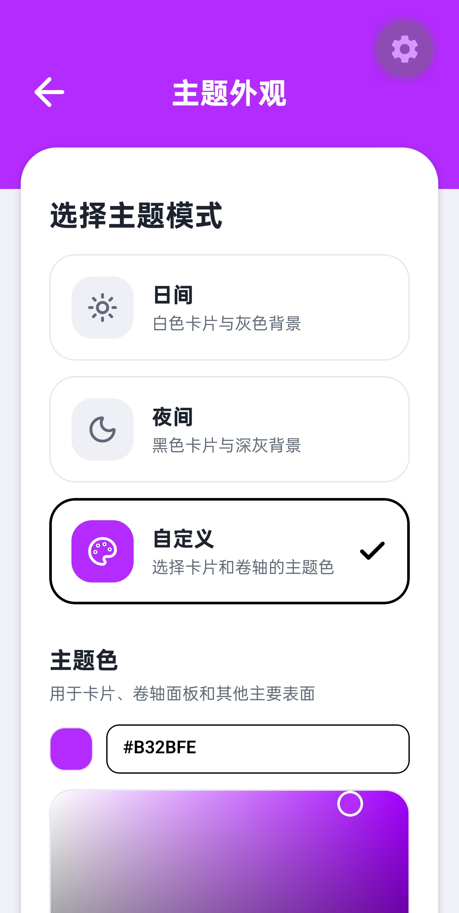

# 易词通（Ez Word）

易词通是一款面向国内 Android 用户的本地优先英语单词记忆 App。它通过 CSV 导入个人词库，支持认识单词、选词填空、听力测试、错题回顾、单词再练、主题定制和本地存档，帮助用户完成从新词学习到复习巩固的闭环。

项目当前只支持 Android，不提供 iOS、Web、账号登录、云端同步或自建服务器。DeepSeek 是可选能力，仅在用户主动配置 API Key 并使用音标、例句生成时访问网络。

> [!NOTE]
> R2 已完成，`v0.1.0` 签名 APK 已发布到 GitHub Releases，并通过覆盖升级和 Release 资产校验。

## 功能

- 使用 CSV 导入个人词库，兼容中英文列名和旧版三列格式。
- 每日任务包含认识单词、选词填空、听力测试和完成记录。
- 错词自动进入错题本，支持错题回顾、手动添加和单词再练。
- 使用 Android TTS 朗读单词，支持播放速度、间隔和复习范围设置。
- 支持日间、夜间和自定义主题，并适配大字号、TalkBack 与减少动画。
- 支持导入导出本地 JSON 存档，导出内容不包含 DeepSeek API Key。
- 可选调用 DeepSeek 批量补齐音标和例句，单词和中文释义不会被修改。
- 所有核心业务数据保存在本机 SQLite，不依赖自建后端。

## 界面预览

<table>
  <tr>
    <td align="center"><br />首页</td>
    <td align="center"><br />认识单词</td>
    <td align="center"><br />选词填空</td>
  </tr>
  <tr>
    <td align="center"><br />听力测试</td>
    <td align="center"><br />错题本</td>
    <td align="center"><br />主题外观</td>
  </tr>
</table>

## 下载与安装

### 正式 APK

正式签名 APK 已发布到 [GitHub Releases](https://github.com/Saisa7L/ez-word/releases/tag/v0.1.0)。这是首个 Android 开源测试版，发布说明见 [docs/releases/v0.1.0.md](docs/releases/v0.1.0.md)。

### 当前开发体验

当前可以通过 Expo Go 在 Android 真机上运行源码：

```powershell
git clone https://github.com/Saisa7L/ez-word.git
Set-Location ez-word
npm ci
npx expo start --lan
```

手机和电脑需要处于同一局域网，然后使用 Expo Go 扫描终端二维码。正式签名 APK 的本地构建和发布步骤见 [docs/RELEASING.md](docs/RELEASING.md)。

## 使用流程

1. 在“我的 → 导入单词”中选择 UTF-8 CSV 文件。
2. 在“我的 → 通用设置”中配置每日新词数量、听力速度和复习提醒。
3. 从首页进入“每日任务”，依次完成认识单词、选词填空和听力测试。
4. 在完成页保存学习记录，答错单词会进入错题本。
5. 使用错题回顾和单词再练巩固已学内容。
6. 在“我的 → 本地存档”中定期导出 JSON 备份。

CSV 示例和导入规则见 [docs/REQUIREMENTS.md](docs/REQUIREMENTS.md) 与 [assets/templates/words-template.csv](assets/templates/words-template.csv)。

## Android 权限与数据位置

App 当前只申请完成核心功能所需的权限：

- 相册/媒体选择：仅在用户主动选择头像或名片背景时访问。
- 文件选择与保存：通过 Android 系统文件选择器读取 CSV、导入存档和导出存档，不自动扫描其他文件。
- 网络：仅在用户主动测试或调用 DeepSeek 时访问 `api.deepseek.com`。
- 不申请相机或麦克风权限。

数据位置：

- `vocabulary.db`：位于 Android 应用私有目录，保存词库、学习记录、错题、设置、主题和个人资料。
- Android SecureStore：保存用户主动填写的 DeepSeek API Key。
- 用户选择的文件位置：保存用户主动导出的 JSON 存档和名片图片。

数据库没有额外加密，依赖 Android 应用沙箱隔离。设备被 root、系统备份或调试环境可能改变这一边界，详见 [PRIVACY.md](PRIVACY.md)。

## 技术与项目结构

- Expo SDK 57
- React Native 0.86
- TypeScript 6
- Expo Router
- SQLite v21
- Lucide React Native

```text
src/
├─ app/          页面与路由
├─ application/  任务启动等用例编排
├─ components/   通用 UI
├─ constants/    主题、资源和固定配置
├─ database/     SQLite 迁移、schema 和仓库
├─ domain/       领域类型
├─ features/     任务、导入、AI、存档、主题和资料
├─ hooks/        复用交互状态
├─ services/     网络、文件、TTS 和安全存储
└─ utils/        无状态工具
```

详细设计见 [docs/ARCHITECTURE.md](docs/ARCHITECTURE.md)、[docs/DATA_FLOW.md](docs/DATA_FLOW.md) 和 [docs/DATABASE.md](docs/DATABASE.md)。

## 本地开发

环境要求：

- Windows、macOS 或 Linux
- Node.js 22.5 或更高版本
- npm
- Android 真机和 Expo Go，或后续配置完成的 Android 开发环境

常用命令：

```powershell
npm ci
npx expo start --lan
npm run check
npm run check:release
npm run docs:check
npm run build:android:release
```

`npm run check` 执行格式、文档、类型、Lint、覆盖率和 Expo Doctor 检查。`npm run check:release` 在此基础上执行 Android 离线导出和性能预算检查。

`npm run build:android:release` 需要本机 JDK、Android SDK 和仓库外的签名凭据，详细步骤见 [docs/RELEASING.md](docs/RELEASING.md)。

提交前请阅读 [CONTRIBUTING.md](CONTRIBUTING.md)。

## 项目文档

- [文档索引](docs/README.md)
- [项目上下文](docs/PROJECT_CONTEXT.md)
- [架构说明](docs/ARCHITECTURE.md)
- [模块与接口](docs/MODULE_REFERENCE.md)
- [数据流](docs/DATA_FLOW.md)
- [数据库](docs/DATABASE.md)
- [质量与技术债](docs/QUALITY_AND_TECH_DEBT.md)
- [开源发布计划](docs/OPEN_SOURCE_RELEASE_PLAN.md)

## 隐私、安全与反馈

- 数据处理说明：[PRIVACY.md](PRIVACY.md)
- 安全漏洞报告：[SECURITY.md](SECURITY.md)
- 一般问题和隐私咨询：[GitHub Issues](https://github.com/Saisa7L/ez-word/issues)
- 第三方依赖声明：[THIRD_PARTY_NOTICES.md](THIRD_PARTY_NOTICES.md)

请勿在公开 Issue 中粘贴 API Key、签名文件、用户存档、个人资料或其他敏感信息。

## 许可证

本项目使用 [MIT License](LICENSE)。第三方依赖继续遵循各自许可证。
