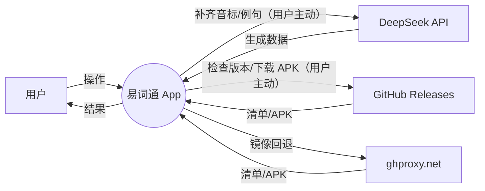
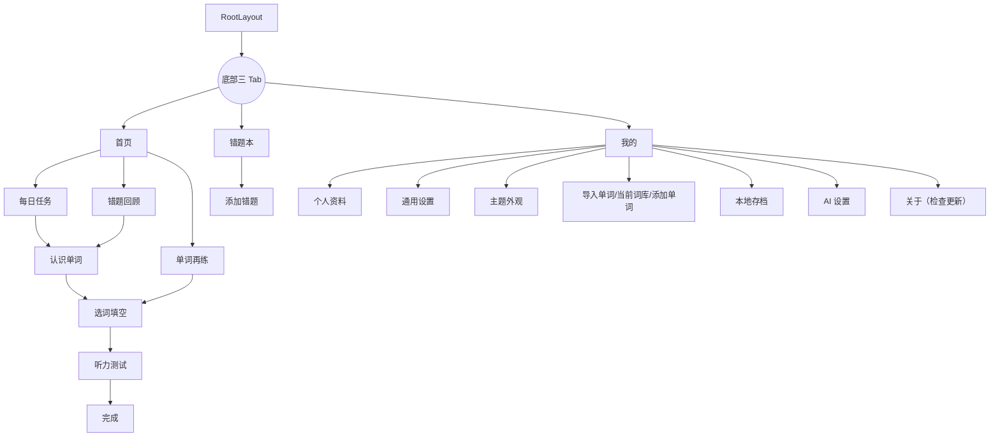
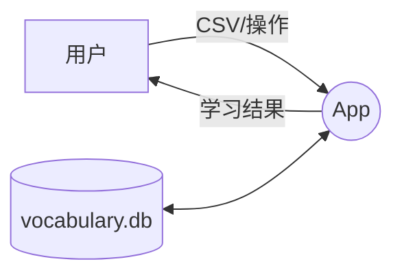
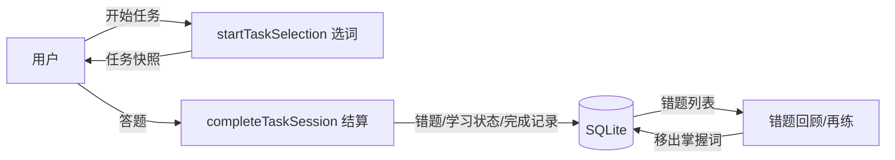
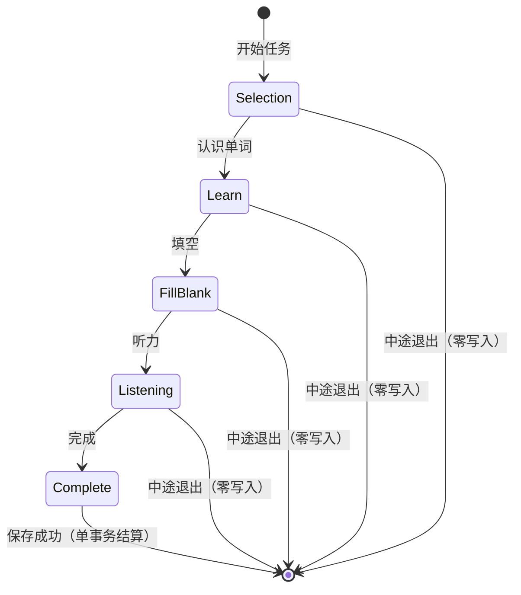

# 设计与架构

最后更新：2026-11-04 17:40
状态：已确认（2026-11-04）
确认记录：已确认（2026-11-04，adoption 批次 2，deep 数据核对零冲突）

## 1. 设计概览

易词通是单机 Expo + React Native Android 应用。SQLite（`vocabulary.db`，v21）是业务数据的唯一持久化来源，页面状态只保存当前交互过程。设计基调是「在已验收的 v1.0.0 上渐进式重构」，不做全面重写、不引入后端。

设计原则：

- 单一数据源：业务数据只在 SQLite；运行态只在 Provider/页面局部状态。
- 依赖单向：`app → application/features/database/services/components`，SQL 只在 `database`，外部 I/O 只在 `services`。
- 先复用再抽象：新增前必须搜索同类实现（组件/Hook/工具/仓库方法），语义一致即复用。
- 小步可回滚：每次只抽离一个明确重复，小批次提交。

## 2. 用户设计映射

| 用户描述（REQUIREMENTS 原话） | 对应模块/数据 | 保留/调整 | 理由 |
|---|---|---|---|
| 每日任务：认识单词→选词填空→听写 | `features/daily-task`（reducer 状态机） | 保留 | v1.0.0 已验收 |
| 学习日以凌晨 5 点为边界 | `utils/studyDate` + `study_sessions.study_date` | 保留 | R1，有专项测试 |
| 错题自动入错题本，手动移出已掌握 | `database/wrongBookRepository`（事务） | 保留 | v1.0.0 已验收 |
| AI 只批量补音标例句，不改单词释义 | `features/ai/generateWordData` + `services/deepSeekService` | 保留 | R9 |
| 关于页检查更新，优先国内镜像 | `services/updateService` + `features/updates` | 保留 | 可信地址白名单约束 |

无专业准则与用户设计冲突项。

## 3. 系统上下文



系统边界：三个外部实体均仅在用户主动操作时访问（AI 设置页、关于页）；学习任务运行全程离线。

## 4. 页面/模块地图



## 5. 分层与模块

### 分层职责

| 层 | 目录/模块 | 职责 | 不应该承担 |
|---|---|---|---|
| 接口/页面 | `src/app` | 路由、页面布局、局部 UI 状态、调用业务和仓库 | 复杂 SQL、跨页面长期状态 |
| 用例/应用 | `src/application` | 任务选词、完成结算等可测试业务动作 | SQL、React 组件、导航 |
| 领域 | `src/domain` | 跨层稳定类型（`taskWord.ts`） | React、Expo、SQLite |
| 数据访问 | `src/database` | 建表迁移、SQL 查询、行→驼峰转换 | 页面导航、弹窗文案 |
| 外部服务 | `src/services` | DeepSeek、TTS、文件选择、安全存储、更新 | React 状态、页面导航 |
| 业务流程 | `src/features` | 任务状态机、导入解析、AI 批处理、存档、主题、更新校验 | 页面视觉细节 |
| 通用 UI | `src/components` | 可复用卡片、弹层、分页、反馈 UI | 业务数据读取 |
| 复用状态 | `src/hooks` | 返回键拦截、分页选择等交互逻辑 | 数据库业务 |
| 常量/资源 | `src/constants` | 主题、资源引用、固定配置 | 可变业务状态 |
| 工具 | `src/utils` | 日期、洗牌、导航锁、格式化、错误码、日志 | 页面组件 |

### 模块清单（核心）

| 模块 | 作用 | 主要入口 |
|---|---|---|
| `features/daily-task` | 每日任务状态机、题目生成、填空/听力区块 | `taskReducer.ts`、`DailyTaskProvider.tsx` |
| `application/daily-task` | 三种任务模式启动选词编排 | `startTaskSelection.ts` |
| `features/word-import` | CSV 选择、解析、校验、导入 | `importWordCsv.ts`、`csv.ts` |
| `features/ai` | 批量补齐并写入音标和例句 | `generateWordData.ts` |
| `features/archive` | 存档序列化、校验和恢复 | `archiveSnapshot.ts` |
| `features/theme` | 运行时主题和动态样式 | `ThemeProvider.tsx` |
| `features/settings` | 设置页区块（AI Key、每日任务表单、关于页信息行与更新弹窗），纯 props 展示 | `AiKeySection.tsx`、`AboutInfoRow.tsx`、`AboutUpdateDialog.tsx` |
| `features/updates` | 更新清单校验、版本比较、可信地址、更新流程编排（检查/下载进度/取消/卸载清理） | `parseUpdateManifest`、`compareVersions`、`useAppUpdate` |
| `database/*Repository.ts` | 各数据域 SQL 访问 | 仓库导出函数 |
| `database/migrations.ts` | 版本迁移注册表 + 单事务执行 | `MIGRATIONS`、`runMigrations` |
| `database/schema.ts` | 当前表字段、存档字段、结构校验 | `validateDatabaseSchema` |
| `services/deepSeekService.ts` | DeepSeek 请求与解析 | `generateWordData` |
| `services/updateService.ts` | 版本检查、APK 下载、系统安装器 | `fetchLatestRelease`、`downloadUpdate`、`installUpdate` |
| `utils/backNavigation` + `navigationActions` | 全局导航锁、唯一导航入口 | `pushOnce`、`backOnce`、`resetToHomeOnce` |
| `utils/appError` + `logger` | 稳定错误码、脱敏日志 | `normalizeAppError`、`buildDiagnosticReport` |
| `hooks/useDailyTaskPhaseGuard` | 任务路由与阶段一致性校验 | `useDailyTaskPhaseGuard` |

### 目录树

```text
vocab-app/
├─ src/
│  ├─ app/            页面与路由（(tabs)/daily-task/review/settings/wrong-book）
│  ├─ application/    用例编排
│  ├─ components/     通用 UI + icons/
│  ├─ constants/      主题、资源、固定配置
│  ├─ database/       迁移、schema、仓库
│  ├─ domain/         领域类型
│  ├─ features/       ai/ archive/ daily-task/ profile/ settings/ theme/ updates/ word-import/ word-library/
│  ├─ hooks/          复用交互状态
│  ├─ services/       外部 I/O
│  ├─ types/          全局类型
│  └─ utils/          无状态工具
├─ tests/             9 个测试文件（67 项）
├─ scripts/           check-docs / performance-budget / build-android-release
├─ plugins/           Expo 配置插件
├─ android/           生成的原生工程（CNG，勿手改）
├─ docs/              项目文档
└─ update/            latest.json 更新清单
```

目录树必须与分层/模块表一致。

## 6. 核心流程详细设计

### 流程 1：每日任务

| 项目 | 内容 |
|---|---|
| 触发 | 首页「每日任务」（错题回顾/单词再练复用同一流程线） |
| 前置条件 | 当前词库有启用词；任务设置行存在（自愈） |
| 输入 | 任务设置（每日数量、听力速度、间隔、随机开关） |
| 正常路径 | 读取设置和未学词 → 生成任务快照 → 认识单词 → 选词填空 → 听力测试 → 完成页 → `completeTaskSession` 单事务写入错题、学习状态、完成记录 |
| 分支 | 错题回顾（复习来源过滤 + 自动移除答对项）；单词再练（跳过认识阶段） |
| 失败路径 | 任务中途退出不写任何数据（阶段守卫 + 导航锁）；完成页保存失败整体回滚 |
| 数据写入 | `study_sessions` + `wrong_book_words/sources` + `word_learning_state` + `words.learning_status`（同一事务） |
| 用户反馈 | 全局 AppFeedbackProvider 提示；错误转 `AppError` 稳定码 |
| 验收点 | 同一学习日多次完成只加完成次数；中途退出零写入 |

### 流程 2：CSV 导入

| 项目 | 内容 |
|---|---|
| 触发 | 我的 → 导入单词 |
| 前置条件 | UTF-8 `.csv`、首行列名、含 word/meaning/phonetic 列 |
| 输入 | 系统文件选择器返回的文件 |
| 正常路径 | 读取 → 解析（中英文列名映射）→ 逐行校验 → SQLite 事务 upsert → 返回新增/更新/跳过数量 |
| 分支 | 已存在单词更新释义音标并恢复启用；CSV 例句非空覆盖、为空保留 |
| 失败路径 | 缺必需列整体拒绝；坏行跳过并报行号与原因 |
| 数据写入 | `words`（事务 upsert，沿用原 `id`） |
| 验收点 | 重导相同单词不重复学（R6） |

### 流程 3：存档

| 项目 | 内容 |
|---|---|
| 触发 | 我的 → 本地存档（导出/恢复） |
| 正常路径 | 导出：固定 10 表按 `ARCHIVE_TABLE_DEFINITIONS` 序列化 JSON；恢复：字段类型/范围/URI/主键/引用完整性校验 → 单事务整体替换 → `ensureSettingsRows` 自愈 → 刷新主题和页面 |
| 失败路径 | 非法文件拒绝，原数据不动 |
| 数据写入 | 全部业务表（同一主连接事务，外键生效） |
| 验收点 | 存档不含 API Key；v10-v21 旧存档兼容 |

### 流程 4：检查更新

| 项目 | 内容 |
|---|---|
| 触发 | 关于页 → 检查更新 |
| 正常路径 | ghproxy.net 清单 → GitHub Raw/API 回退 → 版本比较 → 用户确认 → 下载（镜像→GitHub 回退，进度可取消）→ 大小/MD5 校验 → Android 系统安装器 |
| 失败路径 | 双源失败提示用户自行访问 GitHub Releases；清单非法拒绝 |
| 数据写入 | APK 暂存应用缓存 |
| 验收点 | 只信任本项目 Release 和 ghproxy.net 地址；不静默安装 |

## 7. 数据流（DFD）

### Level 0



### Level 1：每日任务闭环



| 编号 | 处理/存储 | 输入 | 输出 | 规则 |
|---|---|---|---|---|
| P1 | startTaskSelection | 设置 + 启用词 | TaskWord 快照 | 只选未学新词；环节内随机且任务中稳定 |
| P2 | completeTaskSession | 答题结果 | 三类写入 | 单事务，失败整体回滚 |
| P3 | 错题回顾/再练 | 错题来源 | 移出指令 | 学习状态 `wrong` 不作再练来源 |

## 8. 数据模型

> 本节已于 2026-11-04 按代码逐表核对（schema.ts + migrations.ts），零冲突。

### E-R 图

```mermaid
erDiagram
    WORDS ||--o| WORD_LEARNING_STATE : "学习历史"
    WORDS ||--o| WRONG_BOOK_WORDS : "错题"
    WRONG_BOOK_WORDS ||--o{ WRONG_BOOK_SOURCES : "来源"
    WORDS ||--o{ STUDY_SESSIONS : "统计（间接）"
    WORDS {
        int id PK
        text word UK_nocase
        text meaning
        text phonetic
        text example_sentence
        text example_source
        text example_generated_at
        int is_active
        text learning_status
        text created_at
        text updated_at
    }
    WORD_LEARNING_STATE {
        int word_id PK_FK
        text first_learned_at
        text last_learned_at
    }
    WRONG_BOOK_WORDS {
        int word_id PK_FK
        text added_at
        text last_wrong_at
        int wrong_count
    }
    WRONG_BOOK_SOURCES {
        int word_id PK_FK
        text source PK
    }
    STUDY_SESSIONS {
        int id PK
        text completed_at
        text study_date
        int word_count
        int wrong_count
    }
```

### 实体/表结构（10 张，均经 schema.ts 核对）

#### words（当前词库，软删除依赖此表）

| 字段 | 类型 | 约束 | 默认值 | 说明 | 来源 |
|---|---|---|---|---|---|
| id | INTEGER | PK AUTOINCREMENT | — | 历史数据关联 ID | DATABASE.md |
| word | TEXT | NOT NULL COLLATE NOCASE UNIQUE | — | 大小写不敏感唯一 | DATABASE.md + migrations.ts:43 |
| meaning | TEXT | NOT NULL | — | 释义 | 同上 |
| phonetic | TEXT | 可空列 | — | 音标 | 同上 |
| example_sentence / example_source / example_generated_at | TEXT | — | — | 例句/来源(csv\|ai)/写入时间 | 同上 |
| is_active | INTEGER | — | 1 | 0=软清空 | 同上 |
| learning_status | TEXT | unlearned/learned/wrong | unlearned | 学习状态 | 同上 |
| created_at / updated_at | TEXT | — | — | 时间戳 | 同上 |

#### task_settings / review_settings / ai_settings / theme_settings / user_profile

五张单行表，固定 `id = 1`。字段清单与 `schema.ts` 逐项一致（task_settings 5 项设置、review_settings 7 项、ai_settings 1 项、theme_settings 2 项、user_profile 8 项：display_name/bio/avatar_data/background_data/card_content_color/text_stroke_color/text_stroke_width/updated_at）。`ensureSettingsRows` 在迁移和存档恢复后自愈补齐。

#### word_learning_state / wrong_book_words / wrong_book_sources / study_sessions

结构见 E-R 图；`wrong_book_sources` 为 `(word_id, source)` 联合主键，删除错题级联删除来源行。

### 关系与基数

| 关系 | 基数 | 外键/关联 | 删除行为 |
|---|---|---|---|
| words → word_learning_state | 1:0..1 | word_id FK | 跟随删除 |
| words → wrong_book_words | 1:0..1 | word_id FK | 跟随删除（含来源行） |
| wrong_book_words → wrong_book_sources | 1:0..n | (word_id, source) | 级联 |

### 数据字典

| 名称 | 取值 | 含义 |
|---|---|---|
| learning_status | `unlearned` / `learned` / `wrong` | 未学/已学/在错题本 |
| example_source | `csv` / `ai` | 例句来源 |
| source（错题） | `fill` / `listening` / `manual` | 填空/听力/手动添加 |
| theme_mode | 日间 / 夜间 / 自定义 | 主题模式 |

### 不变量

必须永远成立的条件（检查方式）：

1. `learning_status='wrong'` 的单词必存在于 `wrong_book_words`（完成页单事务写入保证 + data.test.ts）。
2. 软清空只改 `is_active`，不删关联历史（导入用例 + 测试）。
3. 重导同一单词沿用原 `words.id`（upsert 语义 + data.test.ts）。
4. 错题移出后单词状态同步为 `learned` 或 `unlearned`（`recordWrongWordsInTransaction` + 测试）。
5. 四张设置表和 user_profile 保留固定单行 id=1（`ensureSettingsRows` 自愈 + 启动校验）。
6. 学习日以本地凌晨 5 点为界（`utils/studyDate` + studyDate.test.ts）。
7. 学习天数 = `COUNT(DISTINCT study_date)`（statsRepository）。
8. 迁移后 `PRAGMA table_info` 字段序校验失败阻止启动（`validateDatabaseSchema`）。

### 生命周期与迁移

| 实体 | 创建 | 更新 | 删除/归档 | 恢复 |
|---|---|---|---|---|
| words | CSV 导入 upsert | 导入/AI 补齐 | 软清空（is_active=0） | 重导恢复启用 |
| 错题 | 任务结算/手动添加 | wrong_count/last_wrong_at 累计 | 移出（级联删来源） | 再练答错重新进入 |
| study_sessions | 完成页写入 | 只增不改 | 不删 | 存档恢复 |

| 版本 | 内容 | 兼容性 | 回滚方式 |
|---|---|---|---|
| v0 → v21 | 21 步迁移注册表（建 words → 软删/设置/学习状态 → AI 例句 → 资料 → 主题 → 索引 → 四设置表拆分 → 错题来源表 → 删 learned_count） | 存档兼容 v10-v21；v11 不支持（显式报错） | 单事务整体回滚；列级幂等（PRAGMA table_info 检查）防重复加列 |

v18 查询索引 4 个：`idx_words_active_status_word`、`idx_learning_last_learned`、`idx_wrong_last_wrong`、`idx_sessions_study_date`（已在 migrations.ts:419-428 核对）。

字段变化同步五处：`schema.ts` → 迁移 → 旧版本默认值 → 存档恢复测试 → 本文档。

## 9. 状态与导航

### 状态归属

| 状态 | 所属层/组件 | 是否持久化 | 谁能改 | 生命周期 |
|---|---|---|---|---|
| 当前主题 | ThemeProvider | 是（theme_settings） | 主题页 | 全局 |
| 任务单词/最终错词/计时 | DailyTaskProvider | 否 | 任务流程 | 离开任务即重置 |
| 填空/听力答案与错误标记 | 填空/听力页面局部 | 否 | 页面 | 离开页面即失 |
| 首页统计、用户名头像 | 首页局部 | 每次从 SQLite 读 | 仓库 | 进入页面加载 |
| 列表分页与选择 | usePaginatedSelection | 选择临时/数据入库 | Hook | 页面内 |
| 全局提示/确认弹窗 | AppFeedbackProvider | 否 | 全局 | 即时 |
| 设置/资料/学习记录 | SQLite | 是 | 仓库/事务 | 永久 |

### 状态机（任务阶段）



阶段守卫：`useDailyTaskPhaseGuard` 校验路由与显式阶段一致；`TaskPhasePlaceholder` 恢复占位。

### 导航规则

- 返回键：`useBackHandler` 拦截 + 确认弹窗（任务中退出需确认）。
- 重复点击/快速返回：`backNavigation` 全局导航锁，`navigationActions` 为唯一 Expo Router 入口（pushOnce/backOnce/replaceOnce/dismissToOnce/resetToHomeOnce）。
- 弹窗：Dialog 通用容器带无障碍语义。
- 空白页/死循环防护：任务阶段占位 + 导航锁最小/最大锁定。

## 10. 外部接口

| 服务 | 用途 | 认证 | 超时/重试 | 失败降级 | 测试/mock | 成本/配额 |
|---|---|---|---|---|---|---|
| DeepSeek API | 批量补齐音标/例句 | 用户自填 Key（SecureStore） | 按服务默认 | 提示错误，不阻塞核心功能 | deepSeekService 可注入解析函数 | 用户自付费 |
| GitHub Releases API/Raw | 更新清单 + APK 回退源 | 无 | 按系统默认 | 双源失败提示自行访问 | updateManifest.test.ts（纯逻辑） | 免费 |
| ghproxy.net | 国内镜像（清单 + APK 优先源） | 无 | 按系统默认 | 自动回退 GitHub | 同上 | 免费 |

## 11. 依赖方向

允许：

```text
app → application / features / database / services / components
application → domain / database / utils
features → domain / database / services / utils
database → domain / constants / utils
services → features（仅纯解析逻辑）
components → constants / hooks / utils
```

禁止：

- `database` 反向依赖页面或 React。
- `components` 直接读取 SQLite。
- `services` 管理页面导航。
- 多个页面分别维护同一份业务常量。
- 页面直接调用 Router（必须经 `navigationActions`）。

## 12. 非功能设计

- 性能：性能预算门禁——Android HBC 6MB、资源总量 1MB、单资源 512KB、资源文件 24 个（`npm run perf:budget`）；图片资源从 3.29MB 优化到 0.78MB。
- 安全/隐私：API Key 仅 SecureStore；存档/日志/Git 排除敏感数据；数据库依赖 Android 沙箱（无应用层加密，见 PRIVACY.md）。
- 可靠性：迁移单事务 + 列级幂等 + 启动 schema 校验；完成结算单事务；更新 APK 双校验。
- 可观测性：`utils/logger` 脱敏日志 + 稳定错误码（AppError）+ `buildDiagnosticReport` 本地诊断。
- 无障碍：TalkBack、大字号、对比度、减少动画均适配（accessibility.test.ts）。
- 兼容性：仅 Android，最低 API 24 / 目标 36；存档 v10-v21。

## 13. 架构质量评审

| 准则 | 要回答的问题 | 当前证据/问题 | 是否阻塞 |
|---|---|---|---|
| 贴合用户设计 | 用户流程/术语保留了吗？ | 五条核心用户设计全部保留（§2）；CSV/任务/错题术语与用户原话一致 | 否 |
| 可维护 | 规则只写一处吗？ | 学习日边界在 `utils/studyDate` 单点；导航锁单点；学习规则在 reducer | 否 |
| 可扩展 | 加 iOS/云同步改哪里？ | 平台耦合集中在 services/speech 等；但 N1-N3 明确不做，不留缝 | 否 |
| 低耦合 | 依赖单向？ | 依赖方向表 + lint 辅助；无循环依赖记录 | 否 |
| 高内聚 | God 模块？ | 三个超限设置页已全部拆分（about 517→245、profile 478→292、word-library 440→271），区块/弹窗/流程各自成文件 | 否 |
| 测试性 | 核心规则可脱离 UI 测试？ | 67 项测试覆盖数据/reducer/导航/更新纯逻辑；SQLite 测试跑 Node 内置 | 否 |
| 不过度设计 | 假想抽象？ | ARCHITECTURE 明示「只有真实复用才抽离」；无预建抽象层记录 | 否 |

## 14. 扩展成本与演进

| 变化 | 现在要改哪里 | 成本 | 现在要不要留缝 | 留缝的代价 |
|---|---|---|---|---|
| 新任务模式（如拼写） | daily-task reducer + startTaskSelection 加模式 | 中 | 否（v1.0.0 已封版） | — |
| 新设置项 | 对应设置表迁移 + 仓库 + 表单 | 小 | 否 | 迁移复杂度 |
| 多平台 | 全面评估（N1 明确不做） | 大 | 否 | — |

只留真实可能发生的缝；不要为假想需求预建抽象层。

## 15. 资源清单

已有资产（v1.0.0 交付，不再要求提供）：App 图标、启动图、导航图标、页面插画（`src/constants/uiAssets.ts` 统一引用）、截图（docs/screenshots/）、CSV 模板（assets/templates/words-template.csv）。

## 16. 关键决策

| 决策 | 选择 | 理由 | 替代方案 | 代价/风险 | 何时重新评估 |
|---|---|---|---|---|---|
| 平台 | 仅 Android（Expo SDK 57 + RN 0.86） | 目标用户国内 Android | iOS/Web | 求广度则弃深度 | 有明确需求时 |
| 数据存储 | SQLite 唯一持久化源 | 本地优先、可测试、迁移成熟 | AsyncStorage/Realm | — | — |
| 状态管理 | Provider + 页面局部 + reducer | 任务流需要集中状态机 | Redux 等全局库 | 过度设计 | — |
| 导航 | navigationActions 唯一入口 + 导航锁 | 防重复导航/空白页 | 直接调 Router | 分散难排查 | — |
| 迁移策略 | 版本注册表 + 单事务 + 列级幂等 | 中断回滚、重复启动安全 | 每步独立提交 | 部分回滚粒度粗 | — |
| AI | DeepSeek 可选、仅补齐数据 | 不引入运行时联网依赖 | 内置 AI | 成本/隐私 | — |
| 分发 | GitHub Releases + 镜像 + App 内更新 | 无商店依赖、国内可达 | 应用商店 | 需自维护更新链路 | 商店政策允许时 |
| 测试 | Node test runner + tsx + 真实 SQLite | 零额外框架依赖 | Jest | — | — |
| 架构演进 | 渐进式重构 | v1.0.0 已验收，避免回归风险 | 全面重写 | 回归风险大 | — |

## 17. 已知结构性问题/技术债

| 问题 | 影响 | 临时方案 | 计划 |
|---|---|---|---|
| 设置页曾超限（about 517→245、profile 478→292、word-library 440→271，已由 M1-T3/T4/T5 拆分） | 维护困难 | 已拆分：展示区块、弹窗、数据/流程 hook 各自成文件，页面只留骨架与样式 | 已完成 |
| 页面直接调用仓库的复杂流程 | 数据编排散在页面 | 简单读取保留直调 | ROADMAP M1-T6 |
| Expo/Metro/Router 传递依赖审计项 | audit 噪音 | 禁止降级 Expo 强修 | Backlog 待评估 |
